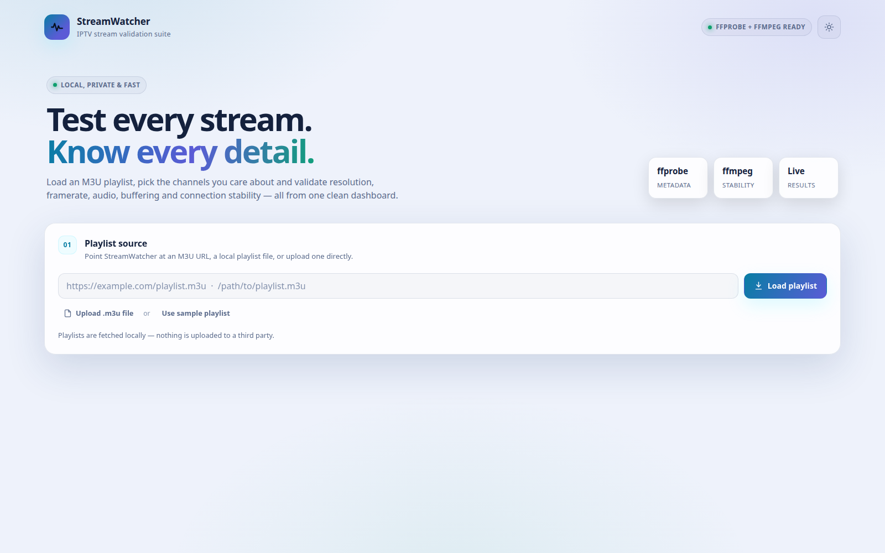

<p align="center">
  <a href="https://discord.gg/UbPRh74PzV">
    
  </a>
</p>


# 📺 StreamWatcher - Professional IPTV Channel Monitoring Suite

<div align="center">


[](https://discord.gg/UbPRh74PzV)

**Real-Time IPTV Stream Validation & Quality Monitoring Dashboard**

[Features](#-features) • [Installation](#-installation) • [Usage](#-usage) • [Configuration](#%EF%B8%8F-configuration) • [Dashboard](#-dashboard)

</div>

---

## 🎯 Overview

**StreamWatcher** is a professional-grade IPTV stream validator with a real-time web dashboard. Designed for network engineers, ISPs, and content providers who need reliable stream quality monitoring and channel validation. Features sequential testing to isolate server-side issues, cumulative quality metrics, and beautiful live analytics.

### ✨ Key Highlights

- 🔄 **Sequential Testing** - Test channels one at a time to isolate server-side performance issues
- 📊 **Real-time Dashboard** - Live updates every second with progress tracking
- 🔁 **Loop Testing** - Single run, loop X times, or infinite loop modes
- 🎬 **Resolution Detection** - Automatic 720p, 1080p, and 4K detection with minimum-resolution checks
- 🎞️ **Framerate Detection** - Reads real stream FPS and flags streams below your threshold
- 🖤 **Black screen detection** - Detects streams that report a resolution but show no picture
- 🎭 **Fake-FPS detection** - Uses frame decimation to catch streams that duplicate frames to fake 50/60 fps
- 🔁 **Auto-retry** - Optionally retry failed probes on 4xx/5xx HTTP errors
- 📈 **Cumulative Metrics** - Track buffering and disconnects across all loop iterations
- 🌐 **External M3U Links** - Load playlists from URLs, local files, or direct uploads
- 📡 **Xtream Codes support** - Paste an Xtream `get.php`/`player_api.php` URL, browse categories, and load only the groups you want
- ⏱️ **Total Time Tracking** - Cumulative time display from initial start
- 🌓 **Dark Mode** - Toggle between light and dark themes
- 🔍 **Channel Selection UI** - Interactive web UI with group filtering, search, and checkboxes

## 🌐 Live demo (simulated)

Try the UI without installing anything: **https://nigel1992.github.io/IPTV-StreamWatcher/**

> ⚠️ This is a **simulated demo** — no real streams are probed and no data leaves your browser. Run `python run_local_test.py` locally for real validation.

## 📸 Screenshots



---

## 🚀 Features

### Testing Capabilities

- **Stream Validation** - Uses `ffprobe` to detect video/audio streams
- **Resolution Detection** - Automatically identifies 720p (HD), 1080p (Full HD), and 4K (Ultra HD)
- **Framerate Detection** - Reads average/real FPS (e.g. 25, 29.97, 50, 60 fps) and validates minimum FPS
- **Audio Detection** - Reports audio codec and channel count
- **Buffering Detection** - Tracks buffering events and counts occurrences
- **Disconnect Tracking** - Monitors connection failures and reconnection attempts
- **Configurable Duration** - Set custom test duration with seconds/minutes/hours units (up to 7 days)
- **Sequential Execution** - Tests one channel at a time to prevent local system bottlenecks
- **Optional Parallelism** - Probe up to 10 channels at once when speed matters more than isolation

### Loop Modes

| Mode | Description |
|------|-------------|
| **Single Run** | Test all channels once |
| **Loop X Times** | Repeat testing for a specified number of iterations (1-100+) |
| **Infinite Loop** | Continuous testing until manually stopped |

### Dashboard Features

- **Live Progress Bar** - Visual progress indicator
- **Summary Cards** - Passing streams, issue counts, average framerate and completion
- **Status Indicators** - Pending (gray), Testing (blue), Pass (green), Issue (amber/red)
- **Resolution & Framerate Columns** - Detected values with threshold warnings
- **Buffering Count** - Total buffering events across all loops
- **Disconnect Count** - Cumulative disconnections across iterations
- **Details Column** - Error messages, codecs, bitrate, and stream information
- **Search & Filter** - Filter results by channel name, group, URL or status
- **Dark Mode** - Eye-friendly dark theme with localStorage persistence
- **Responsive Design** - Adapts to different screen sizes

---

## 📦 Installation

### Prerequisites

- **Python 3.13+** (tested on 3.13.7)
- **ffprobe** (part of FFmpeg package)
- **Linux/macOS/Windows** with terminal access

### Install FFmpeg

**Ubuntu/Debian:**
```bash
sudo apt update
sudo apt install ffmpeg
```

**macOS:**
```bash
brew install ffmpeg
```

**Windows:**
Download from [ffmpeg.org](https://ffmpeg.org/download.html) and add to PATH

### Clone Repository

```bash
git clone https://github.com/Nigel1992/streamwatcher.git
cd streamwatcher
```

### Setup Virtual Environment

```bash
python3 -m venv .venv
source .venv/bin/activate  # On Windows: .venv\Scripts\activate
```

### Install Dependencies

```bash
pip install -r requirements.txt
```

---

## 🎮 Usage

### Basic Usage

```bash
python run_local_test.py
```

This starts the local StreamWatcher web app and opens the setup UI in your default browser:

```
http://localhost:9001
```

You can also pre-fill the playlist field by passing an M3U URL or local file:

```bash
# Local M3U file
python run_local_test.py data/test_sample.m3u

# External M3U URL
python run_local_test.py https://example.com/playlist.m3u8

# Choose a different port / don't open a browser
python run_local_test.py --port 9100 --no-browser
```

### Setup UI

The setup screen guides you through the full test configuration (one step at a time):

1. **Load a playlist** - paste an M3U URL, enter a local path, upload a `.m3u` file, use the sample playlist, **or** paste an Xtream Codes `get.php`/`player_api.php` URL
2. **Choose categories (Xtream only)** - pick the groups you want, then load their streams (with a live progress dialog)
3. **Select channels** - search, filter by group, select all / only visible / clear, or pick exactly what to test
4. **Set test duration** - seconds, minutes or hours per channel
5. **Choose loop mode** - single run, loop X times, or infinite
6. **Choose what to test** - resolution, framerate, audio, buffering, disconnects & errors, smoothness/frame-pacing, picture/black screen
7. **Auto-retry (optional)** - retry on 5xx/4xx HTTP errors, with a configurable retry count
8. **Set thresholds (optional)** - minimum resolution (e.g. 720p/1080p) and minimum framerate (e.g. 25/30/60 fps)
9. **Start testing** - the live dashboard opens automatically

### View Dashboard

The dashboard opens automatically at:

```
http://localhost:9001/results.html
```

It updates every second and includes resolution, framerate, buffering, error, and connection details for every channel.

### Stop Testing

Click **Stop** on the dashboard, or press `Ctrl+C` in the terminal to stop the local server.

---

## ⚙️ Configuration

### M3U File Format

Your M3U playlist should follow the standard format. The URLs can be any stream format that ffprobe supports (HLS .m3u8, direct .ts, RTSP, HTTP streams, etc.):

```m3u
#EXTM3U
#EXTINF:-1 tvg-id="channel1" tvg-name="Channel Name" tvg-logo="logo.png" group-title="Group",Channel Name
https://stream.example.com/channel1/playlist.m3u8
#EXTINF:-1 tvg-id="channel2" tvg-name="Another Channel" group-title="Group",Another Channel
http://stream.example.com/live/channel2.ts
#EXTINF:-1 tvg-id="channel3" tvg-name="RTSP Stream" group-title="Group",RTSP Stream
rtsp://stream.example.com:554/live/channel3
```

### Port Configuration

Default HTTP port: `9001`

To change the port, edit `run_local_test.py`:
```python
HTTP_PORT = 9001  # Change to your preferred port
```

### Test Duration

- **Minimum**: 1 second
- **Maximum**: No hard limit (can use days/hours/minutes/seconds units)
- **Default**: 15 seconds

### Loop Iterations

- **Loop X Times**: 1-100+ iterations
- **Infinite**: Runs until stopped manually

---

## 📊 Dashboard

### Real-time Metrics

The dashboard displays:

| Column | Description |
|--------|-------------|
| **Channel** | Channel name, group and stream host |
| **Status** | Current status (pending/testing/pass/issue/error/stopped) |
| **Resolution** | Detected resolution and label (720p/1080p/1440p/4K) |
| **Framerate** | Detected stream FPS (highlighted when below minimum) |
| **Tested** | Seconds tested for current iteration |
| **Errors** | Total error/disconnection count (cumulative) |
| **Buffering** | Total buffering event count (cumulative) |
| **Details** | Codecs, bitrate, stream information or error messages |

### Status Colors

- 🔵 **Testing** - Currently being tested
- ⚪ **Pending** - Waiting to be tested
- 🟢 **Pass** - Stream validated successfully
- 🟠 **Issue** - Buffering, errors or threshold checks failed
- 🔴 **Error** - Stream could not be probed at all
- ⚫ **Stopped** - Test was stopped before this channel finished

### Loop Information

When using loop modes, the dashboard shows:
- **Single Run**: No loop indicator
- **Loop X Times**: "Iteration: 3 · 12 of 20 channels completed"
- **Infinite Loop**: Continuous iterations until stopped

---

## 🏗️ Project Structure

```
streamwatcher/
├── run_local_test.py           # Web app, API and test runner
├── index.html                  # Setup / channel selection UI
├── results.html                # Live results dashboard
├── assets/
│   └── theme.css               # Shared UI theme
├── requirements.txt            # Python dependencies
├── data/
│   └── test_sample.m3u        # Sample M3U playlist
├── src/
│   └── iptv_monitor/
│       ├── config.py          # Configuration
│       ├── db.py              # Database operations
│       └── worker.py          # Stream probing and monitoring logic
└── README.md                  # This file
```

---

## 🔧 Advanced Features

### Sequential vs Concurrent Testing

**Sequential Testing** (default):
- Tests one channel at a time
- Isolates server-side performance issues
- Prevents local system resource bottlenecks
- Recommended for accurate server validation

### Persistent Metrics Across Loops

When using loop modes, the following metrics persist across iterations:
- **Buffering Count** - Cumulative total across all loops
- **Disconnect Count** - Total disconnections across iterations
- **Total Time** - Cumulative time from initial test start

### Database Storage

Test results are stored in SQLite database:
```
iptv_monitor.db
```

Contains:
- Channel information
- Test history
- Metrics and timestamps

---

## ☁️ Free cloud deployment (optional)

StreamWatcher is primarily a **local** tool, but you can share it via a free container host.

**Dockerfile** (already compatible):
```dockerfile
FROM python:3.11-slim
RUN apt-get update && apt-get install -y ffmpeg && rm -rf /var/lib/apt/lists/*
WORKDIR /app
COPY . .
RUN pip install --no-cache-dir -r requirements.txt
EXPOSE 9001
CMD ["python", "run_local_test.py", "--no-browser", "--port", "9001"]
```

Deploy the image to **Hugging Face Spaces**, **Koyeb**, **Render**, or **Fly.io** (all have free tiers).
⚠️ Hosting publicly exposes users' IPTV URLs/credentials and runs ffmpeg on third-party URLs — add authentication and limits before sharing.

## 🐛 Troubleshooting

### Port Already in Use

If port 9001 is occupied:
```bash
sudo lsof -i :9001 | grep -v COMMAND | awk '{print $2}' | xargs -r sudo kill -9
```

Or change the port in `run_local_test.py`.

### FFprobe Not Found

Ensure FFmpeg is installed:
```bash
ffprobe -version
```

If not installed, see [Installation](#-installation) section.

### Port Already in Use

StreamWatcher automatically picks the next free port (9002, 9003, …) and prints the URL it chose. You don't need to kill anything. Use `--port` if you want to jump to a specific port.

### Browser Not Opening

Manually navigate to the URL printed in the terminal, for example:
```
http://localhost:9001
```

---

## 📝 Example Output

```
[INFO] StreamWatcher UI: http://localhost:9001
Starting 10 channel checks (duration=15s)...

Results:
3ABN Canada: pass - [Video: 720p / h264 / 30 fps] [Audio: aac / 2ch] [1280x720, 30 fps]
3ABN English: pass - [Video: 1080p / h264 / 25 fps] [Audio: aac / 2ch] [1920x1080, 25 fps]
...
```

## 💖 Support the Project

All donations go towards your chosen charity. You can pick any charity you'd like, and 5% is retained due to Ko-Fi fees. As a thank you, your name will be listed as a supporter/donor in a GitHub project. Feel free to email me at thedjskywalker@gmail.com for proof! :)

[](https://ko-fi.com/nigel1992)
[](https://www.paypal.com/donate/?hosted_button_id=KYV9ARF99ZSCE)

---

## 🤝 Contributing

Contributions are welcome! Please feel free to submit a Pull Request.

### Development Setup

1. Fork the repository
2. Create your feature branch (`git checkout -b feature/AmazingFeature`)
3. Commit your changes (`git commit -m 'Add some AmazingFeature'`)
4. Push to the branch (`git push origin feature/AmazingFeature`)
5. Open a Pull Request

---

## 📄 License

This project is licensed under the MIT License - see the [LICENSE](LICENSE) file for details.

---

## 🙏 Acknowledgments

- FFmpeg team for the excellent `ffprobe` tool
- The IPTV community for format standards and inspiration
- All contributors who help improve this project

---

## 📞 Support

If you encounter any issues or have questions:

1. Check the [Troubleshooting](#-troubleshooting) section
2. Open an [issue](https://github.com/Nigel1992/streamwatcher/issues)
3. Start a [discussion](https://github.com/Nigel1992/streamwatcher/discussions)

---

<div align="center">

**⭐ If you find this project useful, please consider giving it a star! ⭐**

Made with ❤️ by [Nigel1992](https://github.com/Nigel1992)

</div>